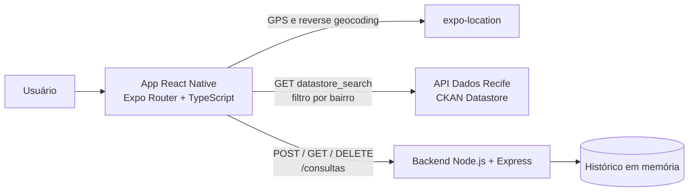

# Monitor Recife — Documento de Especificação de Software

**Autor:** Júlio César Martins Soares  
**Data:** 05/11/2026
**Repositórios do projeto:**
- App: https://github.com/Soares107/acidentes-recife-app
- Backend: https://github.com/Soares107/acidentes-recife-backend

## Sumário

1. [Termo de Abertura do Projeto (Project Charter)](#1-termo-de-abertura-do-projeto-project-charter)
2. [Histórias de Usuário](#2-histórias-de-usuário-user-stories)
3. [Requisitos do Sistema](#3-requisitos-do-sistema)
4. [Caso de Uso Principal e Tratamento de Erros](#4-caso-de-uso-principal-e-tratamento-de-erros)
5. [Arquitetura e Escolha da Stack Tecnológica](#5-arquitetura-e-escolha-da-stack-tecnológica)
6. [Critérios de Aceite e Definição de Pronto](#6-critérios-de-aceite-e-definição-de-pronto-definition-of-done)
7. [Como executar o projeto](#7-como-executar-o-projeto)
8. [Riscos, premissas e evolução futura](#8-riscos-premissas-e-evolução-futura)

---

## 1. Termo de Abertura do Projeto (Project Charter)

### 1.1 Título do projeto

**Monitor Recife** — ocorrências de trânsito por bairro.

### 1.2 Problema real

Os dados de acidentes de trânsito do Recife são publicados pela Prefeitura no Portal de Dados Abertos, em planilhas e APIs técnicas. Para o cidadão comum, esse formato é praticamente inacessível: motoristas, ciclistas e pedestres não têm uma forma simples de saber quais ocorrências já foram registradas no bairro onde moram, trabalham ou circulam. O dado existe, mas não chega a quem poderia usá-lo para decidir melhor por onde e como se deslocar.

### 1.3 Proposta de valor

Um aplicativo mobile que usa a localização do usuário para identificar o bairro e apresentar, em poucos segundos, as ocorrências registradas ali. O diferencial é transformar dado aberto bruto em informação legível, no celular, sem exigir conhecimento técnico:

- detecção automática do bairro por GPS ou busca manual de qualquer bairro;
- filtro por gravidade (com ou sem vítimas) e busca por endereço;
- tela de detalhe de cada sinistro (situação, condição da via, sinalização, clima, vítima fatal);
- histórico pessoal de consultas, persistido em backend próprio.

### 1.4 Objetivos do projeto

| # | Objetivo | Como será verificado |
|---|----------|----------------------|
| O1 | Tornar os dados abertos de acidentes acessíveis ao cidadão em formato mobile | App exibe ocorrências reais da API do Dados Recife |
| O2 | Demonstrar o uso da localização do dispositivo como parte central da funcionalidade | Bairro é detectado por GPS e usado como filtro da consulta |
| O3 | Demonstrar integração entre app, API pública e backend próprio | Cada consulta é salva (POST), listada (GET) e removível (DELETE) |

### 1.5 Partes interessadas (stakeholders)

| Parte interessada | Interesse |
|-------------------|-----------|
| Cidadãos (motoristas, ciclistas, pedestres) | Consultar ocorrências do seu bairro de forma simples |
| Professor / avaliação da disciplina | Verificar domínio de React Native, consumo de API, geolocalização e backend |
| Autor do projeto | Entregar o projeto completo e documentado |
| Prefeitura do Recife (fonte dos dados) | Uso adequado e transparente dos dados abertos |

### 1.6 Escopo — dentro (IN) desta versão

- Detecção do bairro do usuário via GPS e conversão de coordenadas em bairro (reverse geocoding).
- Busca manual de qualquer bairro de Recife.
- Consulta de acidentes de trânsito de **2024** na API do Portal de Dados Abertos do Recife (CTTU), com filtro por bairro e limite de 100 registros por consulta.
- Lista de ocorrências com filtro "Todos / Com Vítimas / Sem Vítimas" e busca por trecho de endereço.
- Tela de detalhe da ocorrência.
- Backend próprio que registra cada consulta (bairro, coordenadas, quantidade de acidentes), lista o histórico e permite excluir registros.
- Tela de histórico de consultas com exclusão e confirmação.
- Repositórios públicos no GitHub com README e código comentado.

### 1.7 Escopo — fora (OUT) desta versão

- Mapa com marcadores e cálculo de distância (o dataset não possui latitude/longitude por ocorrência).
- Dados de outros anos além de 2024.
- Paginação completa dos mais de 5 mil registros do dataset (a consulta traz até 100 por bairro).
- Login, contas de usuário e sincronização entre dispositivos.
- Banco de dados em disco (o histórico fica em memória no servidor).
- Notificações e alertas em tempo real.
- Publicação nas lojas de aplicativos (execução via Expo Go).
- Previsão ou análise estatística de risco.

### 1.8 Premissas e restrições

- **Premissa:** a API do Portal de Dados Abertos do Recife estará disponível e manterá o formato atual dos campos.
- **Premissa:** o celular e o computador que roda o backend estarão na mesma rede Wi-Fi durante a demonstração.
- **Restrição:** o campo `bairro` do dataset está em CAIXA ALTA e sem acentos, o que exige normalização do nome antes do filtro.
- **Restrição:** o dataset não tem coordenadas por ocorrência, então a localização do usuário é usada para descobrir o bairro, e não para calcular distâncias.
- **Restrição:** projeto individual, com prazo de entrega em 05/11/2026.

---

## 2. Histórias de Usuário (User Stories)

| ID | História | Prioridade |
|----|----------|------------|
| US01 | Como **morador do Recife**, quero ver os acidentes registrados no bairro onde estou, para que eu saiba quais ocorrências já aconteceram na minha região. | Alta |
| US02 | Como **motorista**, quero filtrar as ocorrências entre "com vítimas" e "sem vítimas", para que eu identifique rapidamente as situações mais graves. | Alta |
| US03 | Como **ciclista ou pedestre**, quero buscar um bairro diferente do meu, para que eu avalie a segurança de um trajeto antes de sair de casa. | Alta |
| US04 | Como **usuário curioso**, quero abrir os detalhes de uma ocorrência, para que eu entenda as condições em que o acidente aconteceu (via, sinalização, clima). | Média |
| US05 | Como **usuário recorrente**, quero consultar e apagar meu histórico de buscas, para que eu retome pesquisas anteriores e mantenha a lista organizada. | Média |
| US06 | Como **usuário que prefere privacidade**, quero poder usar o app sem permitir o GPS, para que eu continue consultando bairros digitando o nome. | Média |

### 2.1 Critérios de aceite por história

**US01 — Ver acidentes do meu bairro**
- Dado que concedi a permissão de localização, quando toco em "Detectar meu bairro", então o app mostra o bairro identificado.
- Dado um bairro selecionado, quando toco em "Ver ocorrências", então a lista é carregada com dados da API do Dados Recife.

**US02 — Filtrar por gravidade**
- Quando seleciono "Com Vítimas", então só aparecem ocorrências com número de vítimas maior que zero.
- Quando seleciono "Sem Vítimas", então só aparecem ocorrências sem vítimas.
- Quando seleciono "Todos", então a lista completa carregada é exibida.

**US03 — Buscar outro bairro**
- Quando digito um nome de bairro e toco em "Buscar este bairro", então o bairro digitado passa a ser o selecionado, independentemente de acentos ou maiúsculas.

**US04 — Detalhe da ocorrência**
- Quando toco em um card da lista, então abre a tela "Detalhes do Acidente" com endereço, tipo, data, hora, situação de vítimas e os campos adicionais que existirem no registro.

**US05 — Histórico**
- Cada consulta concluída aparece no histórico com bairro, quantidade de acidentes e data/hora.
- Quando toco na lixeira, então o app pede confirmação e, ao confirmar, remove o registro do histórico.

**US06 — Uso sem GPS**
- Se eu negar a permissão de localização, então o app exibe uma mensagem de erro e a busca manual continua disponível.

---

## 3. Requisitos do Sistema

### 3.1 Requisitos Funcionais (RF)

| ID | Requisito | Prioridade | Histórias |
|----|-----------|------------|-----------|
| RF01 | O sistema deve solicitar permissão de localização, obter as coordenadas do dispositivo e convertê-las em nome de bairro (reverse geocoding). | Alta | US01, US06 |
| RF02 | O sistema deve permitir que o usuário digite manualmente o nome de um bairro para consulta. | Alta | US03, US06 |
| RF03 | O sistema deve normalizar o nome do bairro (caixa alta, sem acentos e sem espaços nas pontas) antes de consultar a API. | Alta | US01, US03 |
| RF04 | O sistema deve consultar a API do Dados Recife filtrando por bairro e exibir as ocorrências em lista, com tipo, endereço, data, hora e indicação de vítimas. | Alta | US01 |
| RF05 | O sistema deve permitir filtrar a lista por gravidade (todos, com vítimas, sem vítimas) e buscar por trecho de endereço. | Alta | US02 |
| RF06 | O sistema deve exibir uma tela de detalhe ao tocar em uma ocorrência, mostrando apenas os campos preenchidos no registro. | Média | US04 |
| RF07 | O sistema deve enviar ao backend (POST) cada consulta realizada, com bairro, coordenadas e quantidade de acidentes encontrados. | Alta | US05 |
| RF08 | O sistema deve listar (GET) o histórico de consultas salvo no backend, das mais recentes para as mais antigas. | Alta | US05 |
| RF09 | O sistema deve permitir excluir (DELETE) uma consulta do histórico, com confirmação do usuário. | Média | US05 |
| RF10 | O backend deve rejeitar o cadastro de consulta sem o campo `bairro`, retornando erro 400. | Média | US05 |
| RF11 | O backend deve retornar erro 404 ao tentar excluir uma consulta inexistente. | Baixa | US05 |

### 3.2 Requisitos Não Funcionais (RNF)

| ID | Categoria | Requisito |
|----|-----------|-----------|
| RNF01 | Desempenho | A lista de ocorrências deve ser exibida em até 3 segundos em conexão Wi-Fi comum, com indicador de carregamento enquanto aguarda. |
| RNF02 | Compatibilidade | O aplicativo deve funcionar em Android (testado) e iOS (suportado pelo Expo, não testado), com interface adaptada a telas pequenas e respeitando as áreas seguras do dispositivo. |
| RNF03 | Resiliência | Falhas de rede ou do backend devem gerar mensagens claras e não podem impedir a exibição de dados já carregados da API pública. |
| RNF04 | Privacidade | A localização só é usada após permissão explícita do usuário e só é enviada ao backend próprio do projeto, nunca a terceiros além do serviço de geocodificação do sistema. |
| RNF05 | Manutenibilidade | O código deve separar telas (`app/`) de serviços (`services/`) e conter comentários explicativos nas decisões principais. |
| RNF06 | Usabilidade | A interface deve manter identidade visual consistente (paleta, cartões, ícones) e usar cores semânticas: vermelho para "com vítimas" e verde para "sem vítimas". |
| RNF07 | Portabilidade da configuração | O endereço do backend deve estar concentrado em uma única constante, facilitando a troca de IP entre ambientes. |

---

## 4. Caso de Uso Principal e Tratamento de Erros

### 4.1 Caso de uso: consultar ocorrências do meu bairro

| Campo | Descrição |
|-------|-----------|
| **Ator principal** | Usuário do aplicativo |
| **Atores secundários** | API do Dados Recife, serviço de geocodificação do dispositivo, backend próprio |
| **Pré-condições** | App aberto; dispositivo com internet; backend em execução (para salvar o histórico) |
| **Pós-condição de sucesso** | Lista de ocorrências exibida e consulta registrada no histórico |

**Fluxo principal**

1. **Passo 1 — Ação de entrada do usuário:** o usuário toca em "Detectar meu bairro" (ou digita um bairro e toca em "Buscar este bairro") e depois toca em "Ver ocorrências".
2. **Passo 2 — Processamento e regras de negócio:**
   1. o app solicita a permissão de localização e obtém latitude e longitude;
   2. o app converte as coordenadas em nome de bairro;
   3. o app normaliza o nome (caixa alta, sem acentos) para casar com o formato do dataset;
   4. o app consulta a API do Dados Recife filtrando por esse bairro (limite de 100 registros);
   5. o app envia ao backend (POST) o bairro, as coordenadas e a quantidade de acidentes encontrada.
3. **Passo 3 — Retorno na tela:** a tela exibe a lista de ocorrências com ícone do tipo de envolvido, data, hora e selo "Com vítimas" ou "Sem vítimas". A consulta passa a aparecer no histórico.

### 4.2 Fluxos de exceção

| # | Situação de erro | Comportamento do sistema |
|---|------------------|--------------------------|
| E1 | Permissão de localização negada | Exibe a mensagem "Permissão de localização negada" e mantém a busca manual disponível. |
| E2 | Não foi possível identificar o bairro pelo GPS | Exibe "Não foi possível identificar o bairro" e orienta a usar a busca manual. |
| E3 | Bairro detectado sem registros no dataset (inclui o caso em que o GPS retorna apenas "Recife") | Exibe "Nenhuma ocorrência encontrada." e o usuário pode buscar outro bairro. |
| E4 | Campo de busca manual vazio | A busca não é executada e nenhum bairro é selecionado. |
| E5 | API do Dados Recife indisponível ou com erro | Exibe mensagem de erro na tela de ocorrências, sem travar o app. |
| E6 | Backend offline ao salvar a consulta | A lista de ocorrências continua sendo exibida normalmente; apenas o salvamento falha de forma silenciosa. |
| E7 | Backend offline ao abrir o histórico | Exibe "Não foi possível carregar o histórico. O backend está rodando?". |
| E8 | Histórico vazio | Exibe o estado vazio "Nenhuma consulta registrada ainda.". |
| E9 | Falha ao excluir uma consulta | Exibe alerta "Não foi possível remover a consulta." e o item permanece na lista. |
| E10 | POST ao backend sem o campo `bairro` | O backend responde 400 com a mensagem "O campo "bairro" é obrigatório". |
| E11 | DELETE de um id inexistente | O backend responde 404 com a mensagem "Consulta não encontrada". |

### 4.3 Casos de uso secundários

- **Ver detalhe de uma ocorrência:** o usuário toca em um card da lista; o app abre a tela de detalhe reaproveitando os dados já carregados, sem nova chamada à API.
- **Gerenciar histórico:** o usuário abre "Ver histórico de consultas", vê os registros salvos e pode removê-los com confirmação.

---

## 5. Arquitetura e Escolha da Stack Tecnológica

### 5.1 Visão geral



### 5.2 Tecnologias

| Camada | Tecnologia | Papel |
|--------|-----------|-------|
| Interface / Frontend | React Native com Expo Router e TypeScript | Telas, navegação baseada em arquivos e lógica de apresentação |
| Localização | `expo-location` | Permissão, GPS e conversão de coordenadas em bairro |
| Ícones | `@expo/vector-icons` (Ionicons) | Ícones de tipo de ocorrência, filtros e ações |
| Lógica / Backend | Node.js com Express e CORS | API REST para registrar e gerenciar o histórico |
| Fonte de dados externa | API do Portal de Dados Abertos do Recife (CKAN Datastore) | Registros de sinistros de trânsito de 2024 |
| Armazenamento | Array em memória no servidor | Histórico de consultas (sem banco em disco) |
| Controle de versão | Git e GitHub | Dois repositórios públicos: app e backend |

### 5.3 Justificativa da stack

React Native com Expo entrega Android e iOS com um único código e permite testar no celular via Expo Go, com acesso simples à geolocalização. Node.js com Express usa a mesma linguagem do app e é suficiente para um CRUD leve. O armazenamento em memória mantém o foco na integração entre localização e dados abertos, com evolução prevista para SQLite ou PostgreSQL.

### 5.4 Estrutura dos repositórios

```
acidentes-recife-app/
├── app/
│   ├── (tabs)/
│   │   ├── index.tsx        # Home: detecção de bairro e busca manual
│   │   └── explore.tsx      # Lista de ocorrências com busca e filtros
│   ├── detalhe/[id].tsx     # Detalhe da ocorrência
│   └── modal.tsx            # Histórico de consultas
└── services/
    ├── location.ts          # Permissão, GPS e reverse geocoding
    ├── api.ts               # Integração com a API do Dados Recife
    └── backend.ts           # Comunicação com o backend próprio

acidentes-recife-backend/
├── index.js                 # Servidor Express com as rotas /consultas
└── package.json
```

### 5.5 Contrato da API do backend

| Método | Rota | Descrição | Respostas |
|--------|------|-----------|-----------|
| GET | `/` | Teste de disponibilidade do servidor | 200 |
| POST | `/consultas` | Registra uma consulta | 201 (criada) · 400 (sem `bairro`) |
| GET | `/consultas` | Lista todas as consultas | 200 |
| DELETE | `/consultas/:id` | Remove uma consulta | 200 · 404 (inexistente) |

**Exemplo de corpo do POST `/consultas`**

```json
{
  "bairro": "Boa Viagem",
  "latitude": -8.1184,
  "longitude": -34.9013,
  "quantidadeAcidentes": 100
}
```

**Exemplo de resposta (201)**

```json
{
  "id": 1,
  "bairro": "Boa Viagem",
  "latitude": -8.1184,
  "longitude": -34.9013,
  "quantidadeAcidentes": 100,
  "criadoEm": "2026-06-22T23:43:04.421Z"
}
```

### 5.6 Modelo de dados

**Consulta (backend)**

| Campo | Tipo | Descrição |
|-------|------|-----------|
| `id` | número | Identificador sequencial gerado pelo servidor |
| `bairro` | texto | Bairro pesquisado (obrigatório) |
| `latitude` / `longitude` | número | Coordenadas da consulta (0 quando a busca foi manual) |
| `quantidadeAcidentes` | número | Total de ocorrências retornadas pela API |
| `criadoEm` | data/hora ISO | Momento do registro |

**Ocorrência (API do Dados Recife) — campos utilizados**

`Protocolo`, `data`, `hora`, `natureza`, `situacao`, `bairro`, `endereco`, `complemento`, `tipo`, `vitimas`, `vitimasfatais`, `pedestre`, `ciclista`, `moto`, `onibus`, `caminhao`, `condicao_via`, `conservacao_via`, `sinalizacao`, `tempo_clima`, `situacao_semaforo`, `velocidade_max_via`.

### 5.7 Decisões técnicas relevantes

- **Normalização do bairro:** o filtro da API CKAN é exato e o dataset guarda os bairros em CAIXA ALTA sem acento; por isso o nome é normalizado (decomposição Unicode, remoção de acentos, maiúsculas e `trim`) antes da consulta.
- **Reaproveitamento de dados:** a tela de detalhe recebe o registro já carregado, evitando nova chamada à API.
- **Falha do backend não bloqueia a leitura:** o salvamento da consulta é tentado depois que os dados da API já foram exibidos.
- **Dispositivo físico:** o app usa o IP local do computador, e não `localhost`, para alcançar o backend a partir do celular.

---

## 6. Critérios de Aceite e Definição de Pronto (Definition of Done)

### 6.1 Critério geral

O sistema deve detectar o bairro por GPS (ou aceitar um bairro digitado), exibir ocorrências reais da API do Dados Recife com filtros e busca, abrir o detalhe de cada ocorrência e registrar, listar e excluir consultas no backend próprio, sem travamentos e com mensagens claras em caso de erro.

### 6.2 Checklist de pronto

- [ ] O app detecta o bairro do usuário por GPS e também aceita bairro digitado.
- [ ] A lista exibe ocorrências reais para um bairro com registros (por exemplo, Boa Viagem).
- [ ] Os filtros "Todos / Com Vítimas / Sem Vítimas" e a busca por endereço funcionam.
- [ ] A tela de detalhe abre ao tocar em uma ocorrência e mostra os campos disponíveis.
- [ ] Cada consulta é salva no backend (POST) e aparece no histórico (GET).
- [ ] A exclusão no histórico pede confirmação e remove o registro (DELETE).
- [ ] Permissão negada, bairro sem dados, API fora do ar e backend offline exibem mensagens claras sem encerrar o app.
- [ ] O backend responde 400 quando falta o `bairro` e 404 ao excluir id inexistente.
- [ ] Os dois repositórios estão públicos no GitHub, com README, e o código está organizado e comentado.
- [ ] Um vídeo de apresentação mostra o funcionamento e explica a integração com a API, a localização e o backend.

### 6.3 Casos de teste de aceitação

| ID | Cenário | Passos | Resultado esperado |
|----|---------|--------|--------------------|
| CT01 | Busca manual com dados | Digitar "Boa Viagem" → Buscar → Ver ocorrências | Lista com ocorrências (até 100) e registro no histórico |
| CT02 | Normalização de acento | Digitar "várzea" ou "VÁRZEA" | A consulta usa "VARZEA" e retorna os registros do bairro, se existirem |
| CT03 | Filtro por gravidade | Na lista, tocar em "Com Vítimas" | Só aparecem ocorrências com vítimas |
| CT04 | Busca por endereço | Digitar parte de um nome de rua | A lista é reduzida às ocorrências com esse trecho |
| CT05 | Detalhe | Tocar em um card | Abre "Detalhes do Acidente" com os campos preenchidos |
| CT06 | Histórico | Abrir "Ver histórico de consultas" | Consultas feitas aparecem, da mais recente para a mais antiga |
| CT07 | Exclusão | Tocar na lixeira → confirmar | O registro some da lista e do backend |
| CT08 | Permissão negada | Negar a localização | Mensagem de erro e busca manual disponível |
| CT09 | Backend offline | Desligar o servidor e consultar um bairro | A lista da API aparece normalmente; o histórico mostra mensagem de erro |
| CT10 | Bairro sem registros | Consultar um nome sem ocorrências | "Nenhuma ocorrência encontrada." |

---

## 7. Como executar o projeto

### 7.1 Backend

```bash
git clone https://github.com/Soares107/acidentes-recife-backend.git
cd acidentes-recife-backend
npm install
npm run dev
```

O servidor sobe em `http://localhost:3000`.

### 7.2 App

```bash
git clone https://github.com/Soares107/acidentes-recife-app.git
cd acidentes-recife-app
npm install
```

1. Descubra o IP local do computador (`ipconfig` no Windows) e ajuste a constante `BACKEND_URL` em `services/backend.ts`, por exemplo `http://192.168.1.7:3000`.
2. Inicie o projeto:
   ```bash
   npx expo start
   ```
3. Escaneie o QR code com o app **Expo Go** (celular e computador na mesma rede Wi-Fi).

---

## 8. Riscos, premissas e evolução futura

### 8.1 Riscos

| Risco | Impacto | Mitigação |
|-------|---------|-----------|
| API do Dados Recife fora do ar ou com mudança de formato | Lista de ocorrências não carrega | Mensagem de erro clara e tratamento de falhas |
| Reverse geocoding retornar apenas "Recife" em vez do bairro | Consulta sem resultados | Estado "nenhuma ocorrência" e busca manual como alternativa |
| IP do computador mudar entre sessões | App não alcança o backend | Constante única de configuração (RNF07) |
| Perda do histórico ao reiniciar o servidor | Histórico vazio após reinício | Limitação documentada; evolução para banco em disco |

### 8.2 Evolução futura

- Persistência em banco de dados (SQLite ou PostgreSQL) para manter o histórico entre reinícios.
- Seleção do ano do dataset e paginação completa dos registros.
- Mapa com ocorrências, caso se consiga geocodificar os endereços.
- Estatísticas por bairro (total, proporção com vítimas, horários de maior incidência).
- Autenticação e histórico por usuário.
- Testes automatizados para os serviços de API e normalização.

---

## Glossário

| Termo | Significado |
|-------|-------------|
| CKAN | Plataforma de dados abertos usada pelo Portal de Dados Abertos do Recife |
| Datastore | API do CKAN que permite consultar linhas de um recurso com filtros |
| Reverse geocoding | Conversão de coordenadas (latitude e longitude) em endereço ou bairro |
| Expo Go | Aplicativo para executar projetos Expo diretamente no celular |
| CTTU | Autarquia de Trânsito e Transporte Urbano do Recife, responsável pelo dataset |
| Sinistro | Termo técnico para acidente de trânsito |
